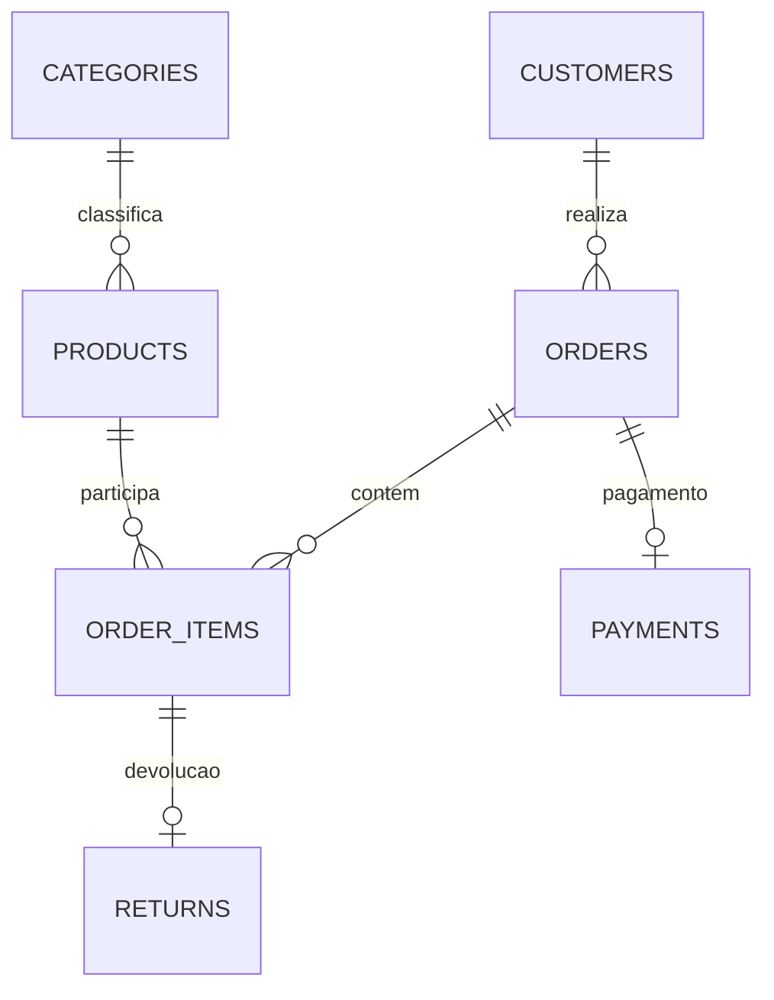

# Modelo relacional e dicionário

| Tabela | Grão | Chave | Campos e relações principais |
|---|---|---|---|
| customers | Um cliente | customer_id | name, email único, city, state, registered_at |
| categories | Uma categoria | category_id | name único |
| products | Um produto | product_id | category_id FK, sku único, name, list_price, unit_cost, active |
| orders | Um pedido | order_id | customer_id FK, ordered_at, status, channel, shipping_fee |
| order_items | Um produto dentro de um pedido | order_id + product_id | Ambas FK; quantity, unit_price, unit_cost, discount |
| payments | Um pagamento original por pedido | payment_id | order_id FK e único, method, status, amount, paid_at |
| returns | Uma devolução agregada por item | return_id | FK composta ao item; quantity, refund_amount, returned_at, reason |

IDs são bigint com identity; valores monetários são numeric(12,2), quantidades inteiras e datas date. As restrições completas estão em `sql/01_schema.sql`. Datas não incluem horário nem fuso neste recorte.

## Normalização
Clientes e categorias não são repetidos em cada pedido. `order_items` resolve a relação muitos-para-muitos entre pedidos e produtos. A chave composta impede repetir um produto no mesmo pedido. Preços e custos nos itens representam fatos históricos da venda, diferentes dos valores atuais do catálogo.

## Integridade
PK impede duplicidade, FK impede referências inexistentes, UNIQUE protege email/SKU e CHECK valida quantidade, preço e estados. O trigger compara a devolução com o item original e a data/status do pedido. Regras de transição de status, edição posterior de itens devolvidos e total de pagamento não são automatizadas: a reconciliação detecta diferenças. Este é um laboratório analítico, não um sistema transacional de produção completo.

## Grão das views
`sales_items`: um item de pedido concluído, incluindo sua devolução opcional.
`sales_orders`: um pedido concluído, somando itens antes de associar métricas de pedido.
`monthly_kpis`: um mês com pedidos concluídos. A consulta de crescimento completa meses ausentes.

Juntar pagamentos diretamente aos itens e somar `payment.amount` repete o pagamento por item. Por isso os indicadores usam agregação no grão adequado.
